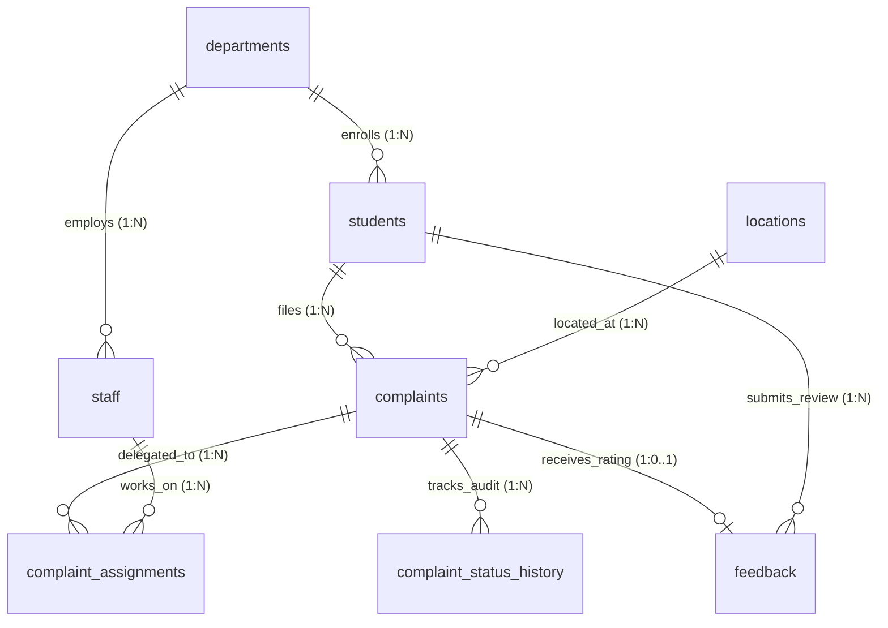

# CAMPUSFIX
### Smart Campus Complaint & Maintenance Management System

A production-grade, relational database management system (DBMS) project built on **MySQL 8.0** to modernize campus incident reporting, technician dispatch, maintenance lifecycle tracking, and student feedback.

---

## 1. Problem Statement

In college and university campuses, maintaining physical infrastructure—such as multimedia classroom projectors, computational laboratories, air conditioning units, plumbing facilities, and electrical grids—is essential for uninterrupted academic operations. 

Traditional campus maintenance processes rely heavily on paper logbooks, verbal complaints, or unstructured messaging channels. These methods suffer from critical operational deficiencies:
- **Lost and Unrecorded Complaints:** Tickets are forgotten, misfiled, or lack timestamp accountability.
- **Opaque Repair Lifecycle:** Students and department heads cannot check whether an issue is under active repair.
- **Unbalanced Workload Distribution:** Supervisors lack visibility into active technician task allocations.
- **No Quality Assurance:** Once a repair is completed, students have no formal channel to review or confirm the fix.
- **Zero Institutional Analytics:** Campus management cannot track equipment failure trends, Mean Time to Resolution (MTTR), or recurring infrastructure hotspots.

---

## 2. Project Objectives

**CAMPUSFIX** provides a centralized, database-driven solution:
- **Student Incident Reporting:** Allows students to log facility failures with location details, category, and urgency.
- **Administrative Triage & Allocation:** Empowers dispatchers to assign qualified technicians to open complaints.
- **Full Lifecycle Auditability:** Automatically tracks state transitions across an auditable state machine (`Pending` &rarr; `Assigned` &rarr; `In Progress` &rarr; `Resolved` &rarr; `Closed` / `Rejected`).
- **Student Review & Verification:** Restricts feedback submissions to verified ticket authors upon completion (1–5 scale).
- **Executive Decision Support:** Generates real-time management reports on resolution efficiency, staff workload, and physical infrastructure failure hotspots.

---

## 3. Technology Stack

- **RDBMS Engine:** MySQL Server 8.0 (InnoDB storage engine for full ACID transaction compliance)
- **Database Tooling:** MySQL Workbench 8.0 CE (Graphical schema design, query development, script execution)
- **SQL Standards:** ANSI SQL / MySQL 8.0 Dialect (DDL, DML, DQL, TCL, Triggers, Stored Procedures, Views)
- **Encoding & Collation:** `utf8mb4` character set with `utf8mb4_unicode_ci` collation
- **Version Control:** Git-friendly architecture with modular, sequentially numbered SQL migration scripts

---

## 4. Project Directory Structure

```text
CAMPUSFIX/
│
├── database/
│   ├── 01_create_database.sql       # Database schema initialization (campusfix, utf8mb4)
│   ├── 02_create_tables.sql         # 8 core relational tables with PKs, FKs, CHECKs, and defaults
│   ├── 03_constraints.sql           # Performance B-Tree indexes & constraint audit queries
│   ├── 04_sample_data.sql           # 208 realistic seed records across all 8 tables
│   ├── 05_queries.sql               # 35 practical queries (DML/DQL, Aggregates, Joins, Subqueries, EXPLAIN)
│   ├── 06_views.sql                 # 5 abstracted database views for students, staff, and leadership
│   ├── 07_triggers.sql              # 4 automated triggers for audit logging and feedback validation
│   ├── 08_procedures.sql            # 4 stored procedures for operations, assignments, and KPI reports
│   ├── 09_transactions.sql          # ACID transaction demonstrations with SQLEXCEPTION rollback handlers
│   ├── 10_data_validation.sql       # 16-point automated data integrity and consistency test suite
│   └── 11_management_reports.sql    # 10 executive management reports for SLA and MTTR tracking
│
├── documentation/
│   ├── project_overview.md          # Architectural specification, 3NF/BCNF analysis, and state machine
│   ├── er_diagram.md                # Entity-Relationship diagram (Mermaid) with cardinalities & keys
│   ├── dbms_concepts.md             # In-depth DBMS viva guide with CAMPUSFIX examples
│   └── project_report.md            # Comprehensive 16-section university academic project report
│
├── README.md                        # Complete project manual, query catalog, and execution guide
└── .gitignore                       # Git exclusions for OS, editor, and database artifacts
```

---

## 5. Database Architecture & Table Descriptions

The database schema is normalized to **Third Normal Form (3NF)** and strictly satisfies **Boyce-Codd Normal Form (BCNF)**:

| Table Name | Entity Description | Target Min | Seeded Rows | Primary & Unique Keys | Referential Rules |
| :--- | :--- | :---: | :---: | :--- | :--- |
| **`departments`** | Academic and facility divisions | 5 | **5** | `PK(department_id)`, `UNIQUE(department_name)` | Parent master entity |
| **`locations`** | Classrooms, labs, libraries, hostels | 12 | **12** | `PK(location_id)`, `UNIQUE(building_name, room_number)` | Master estate entity |
| **`students`** | Enrolled student reporters | 20 | **20** | `PK(student_id)`, `UNIQUE(email)` | `FK(department_id)`: RESTRICT delete, CASCADE update |
| **`staff`** | Technicians, plumbers, supervisors | 10 | **10** | `PK(staff_id)`, `UNIQUE(email)` | `FK(department_id)`: RESTRICT delete, CASCADE update |
| **`complaints`** | Central incident tickets | 35 | **35** | `PK(complaint_id)` | `FK(student_id)`, `FK(location_id)`: RESTRICT delete |
| **`complaint_assignments`** | Technician dispatch logs | 35 | **35** | `PK(assignment_id)` | `FK(complaint_id)`: CASCADE; `FK(staff_id)`: RESTRICT |
| **`complaint_status_history`** | Chronological audit ledger | 50 | **76** | `PK(history_id)` | `FK(complaint_id)`: CASCADE delete |
| **`feedback`** | Student ratings & reviews | 15 | **15** | `PK(feedback_id)`, **`UNIQUE(complaint_id)`** | `FK(complaint_id)`: CASCADE; `FK(student_id)`: RESTRICT |
| **TOTAL** | | **172** | **208** | | |

---

## 6. Entity-Relationship (ER) Model



- **Strict 1:0..1 Feedback Enforcement:** Enforced at the engine level via `CONSTRAINT uq_feedback_complaint UNIQUE (complaint_id)`.
- **Composite Location Uniqueness:** Enforced via `CONSTRAINT uq_locations_building_room UNIQUE (building_name, room_number)`.
- **Domain CHECK Constraints:**
  - `priority IN ('Low', 'Medium', 'High', 'Critical')`
  - `status IN ('Pending', 'Assigned', 'In Progress', 'Resolved', 'Rejected', 'Closed')`
  - `rating BETWEEN 1 AND 5`

For complete field specifications, refer to [er_diagram.md](file:///c:/Users/raoak/Desktop/CAMPUSFIX%20dbms/documentation/er_diagram.md).

---

## 7. Advanced SQL Features & Database Automation

### 1. Reusable Database Views (`06_views.sql`)
- **`v_complaint_details`:** Consolidates complaint, student, department, and location data in a unified schema.
- **`v_pending_complaints`:** Dynamic triage queue filtering unassigned and active tickets sorted by urgency.
- **`v_staff_workload`:** Measures technician task loads without join double-counting via `COUNT(DISTINCT ...)`.
- **`v_department_statistics`:** Institutional KPI dashboard computing complaint counts, resolution percentages, and average ratings.
- **`v_complaint_feedback`:** Combines complaint histories with student reviews via `LEFT JOIN`.

### 2. Automated Database Triggers (`07_triggers.sql`)
- **`trg_complaints_before_update`:** Automatically synchronizes `NEW.updated_at = NOW()`.
- **`trg_complaints_status_audit`:** Automatically logs every state transition into `complaint_status_history` capturing old status, new status, timestamp, and user identity via `COALESCE(@current_session_user, USER(), 'SYSTEM')`.
- **`trg_feedback_before_insert / update`:** Asserts that feedback authors match the original complaint student, and verifies that the ticket is in `Resolved` or `Closed` status before accepting reviews. Non-mutating design eliminates trigger recursion.

### 3. Operational Stored Procedures (`08_procedures.sql`)
- **`sp_assign_complaint(complaint_id, staff_id, assigned_by)`:** Validates inputs, creates an assignment record, and sets status to `'Assigned'`.
- **`sp_update_complaint_status(complaint_id, new_status, changed_by)`:** Validates allowed lifecycle transitions and logs audit history via session context.
- **`sp_get_student_complaints(student_id)`:** Returns personal ticket history for any student.
- **`sp_get_department_report(department_id)`:** Generates executive resolution statistics for any department.

### 4. ACID Transactions & Rollback Demonstration (`09_transactions.sql`)
- **`sp_tx_assign_technician`:** Demonstrates atomic multi-table mutation backed by a `DECLARE EXIT HANDLER FOR SQLEXCEPTION` with `ROLLBACK`.
- **`sp_tx_resolve_complaint`:** Validates active repair state preconditions before committing ticket resolution.
- **`sp_tx_simulate_failure`:** Deliberately executes a valid update followed by an invalid foreign key failure, proving that `ROLLBACK` undoes the initial update and prevents partial writes.

### 5. Management Reporting Suite (`11_management_reports.sql`)
Contains **10 specialized management reports**:
1. Total complaints by department (origination & workload impact).
2. Pending complaints backlog by priority & SLA urgency.
3. Staff workload & technician turnaround performance.
4. Campus-wide complaint resolution rate & operational KPI scorecard.
5. Student satisfaction index & star rating distribution.
6. Most reported complaint categories (Pareto reliability breakdown).
7. Monthly complaint volume & resolution trends.
8. Infrastructure hotspots (campus locations with recurring failures).
9. Student engagement (students filing the most maintenance reports).
10. Mean Time to Resolution (MTTR) by category and priority.

---

## 8. Quick Start & Execution Guide

You can run and showcase the entire project using any of the following methods:

### Method 1: The One-Click Instant Launcher (`start.bat` &mdash; Easiest, Zero Setup)
1. Simply **double-click `start.bat`** in the project folder (or run `python app.py` in your terminal).
2. It automatically initializes the relational database with all 8 tables and 208 seed records, starts a local server, and **instantly pops open your web browser at `http://127.0.0.1:5000`**!
3. The dashboard displays:
   - 📊 **Real-time KPI Cards:** Total complaints (35), resolved (16), active load (8), pending (9), average satisfaction (4.4/5).
   - 📋 **Complaints Triage View:** Live table of all campus incidents with status and priority tags.
   - 👷 **Staff Workload Monitor:** Real-time metrics showing total assignments, active repairs, and completed tickets.
   - 🏢 **Department Statistics:** Resolution percentages and satisfaction ratings across all departments.
   - ⚡ **Interactive Actions:** Click **"Dispatch Technician"** or **"Update Status"** to watch the database engine execute stored procedure logic and trigger audit logs live!
   - 💻 **SQL Query Console:** Type or click presets to run real SQL queries against the database and see results in formatted tables!

### Method 2: One-Click in MySQL Workbench (For MySQL Lab Evaluation)
1. Open **MySQL Workbench 8.0 CE** and connect to your local MySQL instance (`localhost:3306`).
2. Go to **File** &rarr; **Open SQL Script...** (`Ctrl + Shift + O`).
3. Select **`database/00_run_all.sql`**.
4. Click the lightning bolt icon (**Execute All**, or press `Ctrl + Shift + Enter`).
5. The entire database is deployed in 2 seconds, displaying live output grids of loaded tables, active tickets, technician workloads, and department KPIs!
6. To walk an examiner through a live step-by-step workflow, open and run **`database/12_interactive_demo.sql`**.

### Method 3: Command-Line Client
From the project directory, run:
```cmd
"C:\Program Files\MySQL\MySQL Workbench 8.0 CE\mysql.exe" -u root -p < database\00_run_all.sql
"C:\Program Files\MySQL\MySQL Workbench 8.0 CE\mysql.exe" -u root -p campusfix < database\10_data_validation.sql
"C:\Program Files\MySQL\MySQL Workbench 8.0 CE\mysql.exe" -u root -p campusfix < database\11_management_reports.sql
```

### Complete Numerical Script Inventory
For manual inspection or modular deployment, the repository contains 12 sequentially numbered scripts:

```text
Step 00: database/00_run_all.sql              # Master single-file deployment & live showcase
Step 01: database/01_create_database.sql       # Initializes `campusfix` database
Step 02: database/02_create_tables.sql         # Creates 8 tables and core integrity constraints
Step 03: database/03_constraints.sql           # Applies performance B-Tree indexes
Step 04: database/04_sample_data.sql           # Populates 208 realistic sample records
Step 05: database/05_queries.sql               # Executes 35 practical queries and EXPLAIN plans
Step 06: database/06_views.sql                 # Declares 5 database views
Step 07: database/07_triggers.sql              # Implements 4 automated triggers
Step 08: database/08_procedures.sql            # Implements 4 stored procedures
Step 09: database/09_transactions.sql          # Implements ACID transaction demos & rollback
Step 10: database/10_data_validation.sql       # Runs 16-point automated data integrity test suite
Step 11: database/11_management_reports.sql    # Runs the 10 executive management reports
Step 12: database/12_interactive_demo.sql      # Interactive viva evaluation showcase script
```

---

## 9. Sample SQL Operational Commands

Once the database is loaded, you can execute routine operations directly:

```sql
USE campusfix;

-- 1. View high-priority pending tickets in the triage queue
SELECT * FROM v_pending_complaints WHERE priority = 'Critical';

-- 2. Assign staff technician #5 to complaint #31
CALL sp_assign_complaint(31, 5, 'Admin Facilities Desk');

-- 3. Update status to 'In Progress' with audit logging
CALL sp_update_complaint_status(31, 'In Progress', 'Technician Dinesh Sharma');

-- 4. Mark complaint resolved and verify status history transition
CALL sp_update_complaint_status(31, 'Resolved', 'Technician Dinesh Sharma');
SELECT * FROM complaint_status_history WHERE complaint_id = 31;

-- 5. Retrieve personal complaint history for student #1
CALL sp_get_student_complaints(1);

-- 6. Generate departmental resolution KPI report for department #1 (Computer Science)
CALL sp_get_department_report(1);

-- 7. Inspect technician workload distribution
SELECT * FROM v_staff_workload ORDER BY active_complaints DESC;
```

---

## 10. Data Integrity & Verification Test Suite

The automated test script [database/10_data_validation.sql](file:///c:/Users/raoak/Desktop/CAMPUSFIX%20dbms/database/10_data_validation.sql) executes **16 distinct assertion checks**:
- **Threshold Audits:** Asserts all 8 tables meet or exceed their target counts.
- **Orphan Key Audits:** Executes `LEFT JOIN ... WHERE parent.id IS NULL` across all 7 foreign key paths; asserts **0 orphaned records**.
- **Uniqueness Audits:** Asserts 0 duplicate emails, department names, building rooms, or reviews.
- **Domain Range Audits:** Asserts 100% of feedback ratings fall within `[1, 5]`.
- **Author Consistency:** Asserts 0 author mismatches (`feedback.student_id = complaints.student_id`).
- **Lifecycle Preconditions:** Asserts feedback only exists for `Resolved` tickets.

---

## 11. Academic Documentation & Viva Preparation

Comprehensive documentation is provided in the `documentation/` directory:
- [project_overview.md](file:///c:/Users/raoak/Desktop/CAMPUSFIX%20dbms/documentation/project_overview.md) — Architecture design, 3NF/BCNF normalization proof, and lifecycle state machine.
- [er_diagram.md](file:///c:/Users/raoak/Desktop/CAMPUSFIX%20dbms/documentation/er_diagram.md) — Complete visual Mermaid ER diagram, cardinality matrix, and constraint mappings.
- [dbms_concepts.md](file:///c:/Users/raoak/Desktop/CAMPUSFIX%20dbms/documentation/dbms_concepts.md) — University viva voce preparation guide covering 14 core DBMS topics with CAMPUSFIX examples.
- [project_report.md](file:///c:/Users/raoak/Desktop/CAMPUSFIX%20dbms/documentation/project_report.md) — Full 16-section university academic project report ready for college submission.

---

## 12. Future Scope

1. **Web & Mobile Application:** Implement a React/Vue frontend with a Node.js/Python REST API for self-service student reporting.
2. **Media Attachments:** Introduce an `attachments` table linking Amazon S3/Cloud Storage image URLs for photo proof of damaged infrastructure.
3. **Automated SLA Escalation:** Configure the MySQL Event Scheduler to automatically escalate tickets remaining in `Pending` for > 2 hours.
4. **Push & SMS Alerts:** Integrate notification webhooks (Twilio/Firebase) alerting students when technicians update complaint progress.
