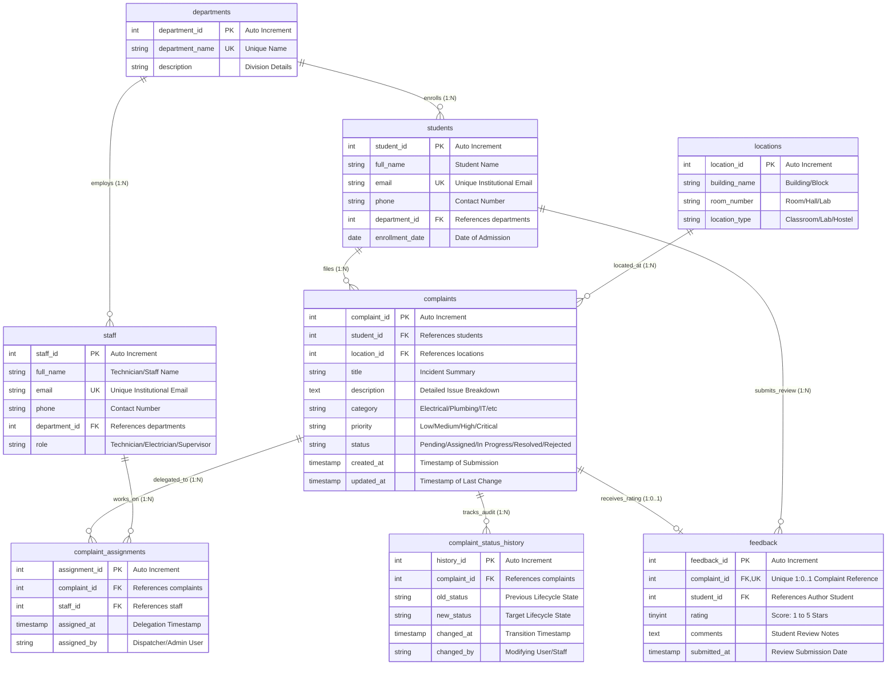

# CAMPUSFIX: Entity-Relationship (ER) Diagram

This document models the conceptual, logical, and physical relational schema for **CAMPUSFIX: Smart Campus Complaint & Maintenance Management System**.

---

## 1. Visual ER Diagram (Mermaid)

---

## 2. Cardinality & Relational Mappings

| Relationship | Cardinality | Parent Table | Child Table | Foreign Key | Enforcement & Referential Action |
| :--- | :---: | :--- | :--- | :--- | :--- |
| **Department Enrolls Students** | `1 : N` | `departments` | `students` | `department_id` | `ON UPDATE CASCADE, ON DELETE RESTRICT` |
| **Department Employs Staff** | `1 : N` | `departments` | `staff` | `department_id` | `ON UPDATE CASCADE, ON DELETE RESTRICT` |
| **Student Files Complaints** | `1 : N` | `students` | `complaints` | `student_id` | `ON UPDATE CASCADE, ON DELETE RESTRICT` |
| **Location Houses Complaints** | `1 : N` | `locations` | `complaints` | `location_id` | `ON UPDATE CASCADE, ON DELETE RESTRICT` |
| **Complaint Assignment History** | `1 : N` | `complaints` | `complaint_assignments` | `complaint_id` | `ON UPDATE CASCADE, ON DELETE CASCADE` |
| **Staff Work Allocations** | `1 : N` | `staff` | `complaint_assignments` | `staff_id` | `ON UPDATE CASCADE, ON DELETE RESTRICT` |
| **Complaint Status Transitions** | `1 : N` | `complaints` | `complaint_status_history` | `complaint_id` | `ON UPDATE CASCADE, ON DELETE CASCADE` |
| **Complaint Feedback (1:0..1)** | `1 : 0..1` | `complaints` | `feedback` | `complaint_id` | **`UNIQUE(complaint_id)`** + `ON UPDATE CASCADE, ON DELETE CASCADE` |
| **Student Submits Feedback** | `1 : N` | `students` | `feedback` | `student_id` | `ON UPDATE CASCADE, ON DELETE RESTRICT` |

---

## 3. Structural Integrity & Architectural Highlights

1. **Surrogate Primary Keys:**
   - Every entity uses an integer surrogate primary key with `AUTO_INCREMENT`. This keeps joins lightweight, stabilizes foreign key links against real-world changes (e.g. email or name modifications), and maximizes B-Tree index cache efficiency in InnoDB.
2. **Strict 1:0..1 Feedback Relationship:**
   - A complaint ticket must not receive multiple conflicting feedback reviews. This is enforced at the database engine level via `CONSTRAINT uq_feedback_complaint UNIQUE (complaint_id)` in the `feedback` table.
3. **Composite Uniqueness on Locations:**
   - Physical rooms are prevented from duplicate declaration within the same building via `CONSTRAINT uq_locations_building_room UNIQUE (building_name, room_number)`.
4. **Cascading vs. Restrictive Delete Semantics:**
   - Dependent transactional records (`complaint_assignments`, `complaint_status_history`, `feedback`) cascade-delete when a parent `complaints` row is removed (`ON DELETE CASCADE`).
   - Primary master accounts (`departments`, `locations`, `students`, `staff`) use `ON DELETE RESTRICT` to protect against accidental deletion of historical campus incident data.
